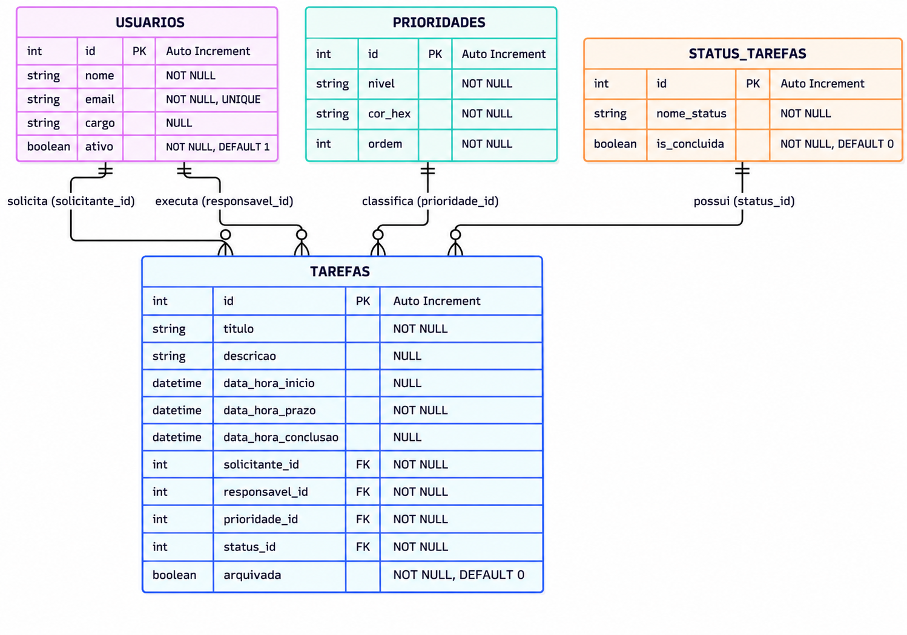

# Modelo Entidade-Relacionamento (ER) — Agende-se

O aplicativo **Agende-se** utiliza um banco de dados relacional SQLite para armazenar localmente as informações relacionadas ao gerenciamento de tarefas empresariais.

O modelo foi desenvolvido para permitir o cadastro de usuários, a classificação de prioridades, o controle das situações das tarefas e o acompanhamento das atividades.

## 1. Diagrama Entidade-Relacionamento

O banco de dados será composto por quatro tabelas:

- `usuarios`
- `prioridades`
- `status_tarefas`
- `tarefas`

O diagrama apresenta os atributos, as chaves primárias, as chaves estrangeiras e os relacionamentos entre as entidades.

## 2. Dicionário de Dados

### Tabela: `usuarios`

Armazena os colaboradores cadastrados no aplicativo.

| Campo | Tipo SQLite | Restrições |
|---|---|---|
| id | INTEGER | PRIMARY KEY AUTOINCREMENT |
| nome | TEXT | NOT NULL |
| email | TEXT | NOT NULL, UNIQUE |
| cargo | TEXT | NULL |
| ativo | INTEGER | NOT NULL, DEFAULT 1, CHECK (ativo IN (0,1)) |

O campo `ativo` permite desativar colaboradores sem excluir seus registros.

### Tabela: `prioridades`

Armazena os níveis de prioridade das tarefas.

| Campo | Tipo SQLite | Restrições |
|---|---|---|
| id | INTEGER | PRIMARY KEY AUTOINCREMENT |
| nivel | TEXT | NOT NULL |
| cor_hex | TEXT | NOT NULL |
| ordem | INTEGER | NOT NULL |

As prioridades previstas são:

- Baixa
- Média
- Alta
- Urgente

### Tabela: `status_tarefas`

Armazena as situações possíveis das tarefas.

| Campo | Tipo SQLite | Restrições |
|---|---|---|
| id | INTEGER | PRIMARY KEY AUTOINCREMENT |
| nome_status | TEXT | NOT NULL |
| is_concluida | INTEGER | NOT NULL, DEFAULT 0, CHECK (is_concluida IN (0,1)) |

As situações previstas são:

- Pendente
- Em andamento
- Concluída
- Cancelada

O campo `is_concluida` identifica se a tarefa foi efetivamente concluída.

### Tabela: `tarefas`

Armazena as atividades cadastradas no aplicativo.

| Campo | Tipo SQLite | Restrições |
|---|---|---|
| id | INTEGER | PRIMARY KEY AUTOINCREMENT |
| titulo | TEXT | NOT NULL |
| descricao | TEXT | NULL |
| data_hora_inicio | TEXT | NULL |
| data_hora_prazo | TEXT | NOT NULL |
| data_hora_conclusao | TEXT | NULL |
| solicitante_id | INTEGER | NOT NULL, FOREIGN KEY |
| responsavel_id | INTEGER | NOT NULL, FOREIGN KEY |
| prioridade_id | INTEGER | NOT NULL, FOREIGN KEY |
| status_id | INTEGER | NOT NULL, FOREIGN KEY |
| arquivada | INTEGER | NOT NULL, DEFAULT 0, CHECK (arquivada IN (0,1)) |

O campo `arquivada` permitirá ocultar tarefas das consultas principais sem excluir definitivamente seus registros.

## 3. Relacionamentos

O modelo apresenta os seguintes relacionamentos:

- **usuarios → tarefas (1:N):** um usuário pode solicitar várias tarefas.
- **usuarios → tarefas (1:N):** um usuário pode ser responsável por várias tarefas.
- **prioridades → tarefas (1:N):** uma prioridade pode estar associada a várias tarefas.
- **status_tarefas → tarefas (1:N):** uma situação pode estar associada a várias tarefas.

As chaves estrangeiras da tabela `tarefas` serão:

- `solicitante_id` → `usuarios.id`
- `responsavel_id` → `usuarios.id`
- `prioridade_id` → `prioridades.id`
- `status_id` → `status_tarefas.id`

## 4. Regras de Integridade

Para garantir a consistência dos dados, serão utilizadas:

- Chaves primárias para identificação dos registros.
- Chaves estrangeiras para relacionar as tabelas.
- Restrições NOT NULL para campos obrigatórios.
- Restrição UNIQUE para impedir e-mails duplicados.
- Valores DEFAULT para inicialização de determinados campos.
- Restrições CHECK para campos booleanos.

Usuários associados a tarefas não poderão ser excluídos fisicamente enquanto existirem registros dependentes.

## 5. Armazenamento Local

O banco de dados será implementado utilizando SQLite, integrado ao aplicativo por meio do plugin Capacitor Community SQLite.

Todas as informações serão armazenadas diretamente no dispositivo Android, permitindo o funcionamento offline.

## 6. Considerações Finais

O modelo relacional do Agende-se foi estruturado com quatro tabelas relacionadas, atendendo aos requisitos de armazenamento local e gerenciamento de tarefas empresariais.

A estrutura permitirá realizar cadastros, consultas, atualizações e gerar indicadores de produtividade a partir dos dados armazenados no dispositivo.
